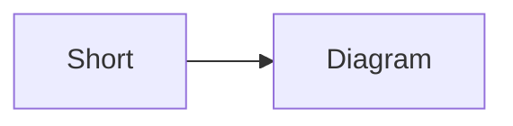
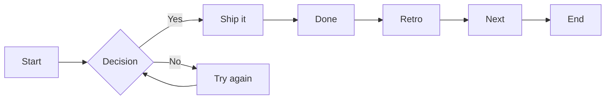
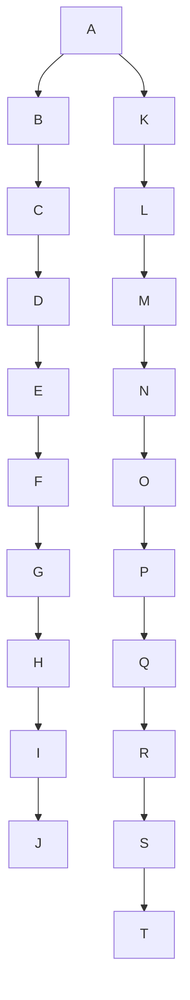
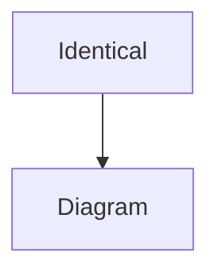

# Mermaid diagram pan/zoom with persistent view state

**Sources used:** the design discussion in this conversation and ADR
`261024-4` (inline pan/zoom for Mermaid diagrams). No feature spec or design
handoff file exists for this work, so `sourceSpec` and `sourceHandoff` are empty.

## 1. Problem

Mermaid diagrams are rendered at fit-width inside a bordered block. Large graphs
are scaled down until labels are unreadable, and the only escape is the
container's horizontal scrollbar. There is no way to zoom into a dense region,
pan around it, or inspect a diagram at a comfortable size.

The rest of docdeck makes the problem harder than a static image viewer would:

- The viewer is repainted wholesale on every agent write and on every light/dark
  theme switch. Any per-diagram view state held only in the DOM is lost.
- A diagram that stretches the page vertically interrupts continuous reading of
  an agent's status log.
- The renderer already has an ordered post-processing pipeline (heading ids,
  task-list tagging, Mermaid promotion, copy buttons). Diagram interaction must
  slot in after `mermaid.run()` without taking over Markdown rendering.
- In-document find deliberately ignores SVG text (ADR `261024-1`), so the
  interaction layer does not have to coexist with highlight painting inside the
  SVG.

## 2. Executive summary

Enhance every rendered Mermaid SVG with an inline viewport/stage pan-zoom layer:

- The existing `.mermaid` node becomes a clipped viewport; a
  `.mermaid-stage` holds the SVG at natural size and receives
  `translate(x, y) scale(s)`.
- Diagrams open at fit-width, with the viewport height derived from the
  diagram's aspect ratio and capped at `70vh`. Short diagrams look exactly as
  they do today; tall ones pan internally instead of stretching the document.
- `100%` means natural SVG size, and neither fit mode ever upscales past 100%.
- Drag pans, `Ctrl`/`Cmd` + wheel zooms toward the pointer, plain wheel scrolls
  the document, double-click fits the whole diagram, and a hover/focus toolbar
  provides zoom out, percentage, zoom in, fit and fullscreen.
- A focused diagram supports `+`/`-`/`0` and arrow keys.
- Fullscreen moves the same viewport node into a themed fixed overlay with a
  same-height placeholder; `Escape`, backdrop click and a close button exit.
- View state lives in a module-level registry keyed by normalized diagram source
  plus occurrence index. It survives live reloads and theme switches, resets when
  the diagram source changes, and is cleared when a different document opens.
- No new dependency. The geometry is pure and unit-tested; the controller has a
  measurement seam for happy-dom, which has no layout engine.

## 3. Design Decisions & Rejected Alternatives

| Decision | Rationale |
| --- | --- |
| Viewport + CSS-transformed stage (ADR `261024-4`) | No dependency, simple screen-space geometry, and the same DOM node can move into the fullscreen overlay. |
| `100%` = natural SVG size; fit never upscales | Matches image-viewer convention and tells the reader when a diagram was scaled down. |
| Initial fit-width; `fit` fits the whole diagram | Keeps today's reading flow for normal diagrams and gives tall diagrams a predictable "show everything" escape hatch. |
| Source + occurrence key in a module-level registry | The viewer repaints wholesale; keying by content lets unchanged diagrams keep their view while edited diagrams reset. |
| Store the view mode (`fit-width`, `fit-whole`, `custom`), not just scale | Fit modes must recompute after a pane-width change; a custom view should keep its scale and be clamped. |
| Plain wheel scrolls; `Ctrl`/`Cmd` + wheel zooms | A full-width diagram must never trap document scrolling. Trackpad pinch arrives as Ctrl+wheel. |
| 4px drag threshold with click suppression after a drag | Mermaid node links and text selection keep working; a real pan never fires a link. |
| Hover/focus toolbar, persistent while custom | Keeps quiet documents clean without hiding the feature from keyboard users; a custom view keeps the controls visible. |
| Fullscreen: fit-whole for untouched views, keep centre/scale for custom views, restore the pre-fullscreen inline view on close | Makes fullscreen useful for both "show me everything" and "I was inspecting this node". This is a deliberate refinement of the conversation's "opens at the current scale": a fit-width diagram at the same scale in a larger frame would look smaller, not bigger. |
| Move the viewport node into the overlay and mark `#app` inert | Reuses the engine, listener set, theme and current DOM; inert prevents focus and pointer access to the background page. |

Rejected alternatives:

- **`svg-pan-zoom` / `@panzoom/panzoom`.** Both own the SVG or wrapper
  lifecycle and must be reconciled with Mermaid re-renders, theme re-renders and
  the source-keyed registry. More coupling than the focused implementation.
- **Mutating the SVG `viewBox`.** Guarantees crisp re-rasterisation but must
  account for `preserveAspectRatio` letterboxing and Mermaid's sizing
  attributes. Kept as the fallback if CSS transforms render softly in WebKitGTK.
- **Always reset to fit on every repaint.** An unrelated agent write would
  repeatedly evict the reader from a zoomed view.
- **Reconciling unchanged diagrams' DOM.** Broader render-pipeline change; the
  source-keyed registry already delivers the required persistence.
- **Always-visible controls.** Adds chrome to every diagram in diagram-heavy
  documents.
- **Native `Element.requestFullscreen()`.** Takes over the display and varies by
  platform; an in-app themed overlay keeps the diagram framed by docdeck.
- **Touch / pinch gestures.** Deferred; docdeck is a desktop app and the gesture
  state would add scope without a current use case.

## 4. Project environment

```
Project:        docdeck (Tauri 2 desktop Markdown viewer)
Platform:       Linux; WebKitGTK (CSS transforms, ResizeObserver, inert)
Frontend:       TypeScript 6, Vite 8, marked 18, highlight.js 11, mermaid 11
Tests:          Vitest 5 with happy-dom 20, colocated as src/*.test.ts
Backend:        Rust (unchanged by this plan)
Package scripts: npm run typecheck, npm run test:web, npm run test,
                 npm run lint:rs, npm run check, npm run tauri dev
Formatting:     existing style (2 spaces, double quotes, semicolons, small
                 focused modules, doc comments on exports)
Git workflow:   no project AGENTS.md exists; implement in the current workspace
                 and do not create branches or pull requests
Dependencies:   none new
```

Implementation order matters: pure geometry first, then the controller, then
renderer integration and styles. Every phase must leave `npm run typecheck` and
`npm run test:web` green.

## 5. Implementation phases

### Phase 1 — Pure transform geometry

**Goal:** implement and test the fit, zoom, clamp and fullscreen hand-off math
without a DOM, so the controller in Phase 2 is only wiring and events.

**Files**

- `[NEW FILE]` `src/mermaid-zoom-math.ts`
- `[NEW FILE]` `src/mermaid-zoom-math.test.ts`

**`[NEW FILE]` `src/mermaid-zoom-math.ts`**

```ts
/** A point in viewport (CSS pixel) coordinates. */
export interface Point {
  x: number;
  y: number;
}

/** A width/height pair in CSS pixels. */
export interface Size {
  width: number;
  height: number;
}

/**
 * The stage transform: `translate(x, y) scale(scale)` with a top-left origin.
 * `x`/`y` are offsets of the diagram's top-left corner inside the viewport.
 */
export interface ZoomTransform {
  scale: number;
  x: number;
  y: number;
}

export interface ScaleLimits {
  min: number;
  max: number;
}

const MIN_NATURAL_SCALE = 0.1;
const MAX_NATURAL_SCALE = 8;

export function clampScale(scale: number, limits: ScaleLimits): number {
  return Math.min(limits.max, Math.max(limits.min, scale));
}

/**
 * Scale limits around a fit scale.
 *
 * The absolute floor is 10% of natural size, but an enormous diagram may need
 * to fit below that; allow zooming out to half the fit scale in that case so
 * the reader can never get stuck above the overview.
 */
export function scaleLimits(fitWhole: number): ScaleLimits {
  return {
    min: Math.min(MIN_NATURAL_SCALE, fitWhole / 2),
    max: MAX_NATURAL_SCALE,
  };
}

/** Largest scale that shows the whole diagram without upscaling it. */
export function fitWholeScale(natural: Size, viewport: Size): number {
  if (
    natural.width <= 0 ||
    natural.height <= 0 ||
    viewport.width <= 0 ||
    viewport.height <= 0
  ) {
    return 1;
  }
  return Math.min(
    1,
    viewport.width / natural.width,
    viewport.height / natural.height,
  );
}

/** Largest scale that fits the diagram's width without upscaling it. */
export function fitWidthScale(natural: Size, viewport: Size): number {
  if (natural.width <= 0 || viewport.width <= 0) return 1;
  return Math.min(1, viewport.width / natural.width);
}

/** Height the viewport needs to show a fit-width diagram without clipping. */
export function fittedHeight(natural: Size, viewport: Size): number {
  return natural.height * fitWidthScale(natural, viewport);
}

export function wheelZoomFactor(deltaY: number): number {
  return Math.exp(-deltaY * 0.002);
}

/** Zooms around a fixed point so the content under it does not move. */
export function zoomAtPoint(
  transform: ZoomTransform,
  point: Point,
  factor: number,
  limits: ScaleLimits,
): ZoomTransform {
  const scale = clampScale(transform.scale * factor, limits);
  if (scale === transform.scale) return transform;

  const ratio = scale / transform.scale;
  return {
    scale,
    x: point.x - (point.x - transform.x) * ratio,
    y: point.y - (point.y - transform.y) * ratio,
  };
}

/**
 * Keeps the diagram inside its viewport: centred on an axis where it is
 * smaller than the viewport, edge-locked where it is larger.
 */
export function clampTranslation(
  transform: ZoomTransform,
  natural: Size,
  viewport: Size,
): ZoomTransform {
  const contentWidth = natural.width * transform.scale;
  const contentHeight = natural.height * transform.scale;

  const x =
    contentWidth <= viewport.width
      ? (viewport.width - contentWidth) / 2
      : Math.min(0, Math.max(viewport.width - contentWidth, transform.x));

  const y =
    contentHeight <= viewport.height
      ? (viewport.height - contentHeight) / 2
      : Math.min(0, Math.max(viewport.height - contentHeight, transform.y));

  return { ...transform, x, y };
}

/** A centred transform for a fit mode. */
export function centeredTransform(
  natural: Size,
  viewport: Size,
  scale: number,
): ZoomTransform {
  return clampTranslation({ scale, x: 0, y: 0 }, natural, viewport);
}

/** The content coordinate currently at the viewport's centre. */
export function contentPointAtViewportCenter(
  transform: ZoomTransform,
  viewport: Size,
): Point {
  return {
    x: (viewport.width / 2 - transform.x) / transform.scale,
    y: (viewport.height / 2 - transform.y) / transform.scale,
  };
}

/** A transform that puts a content point at the viewport centre. */
export function centerOnContentPoint(
  point: Point,
  scale: number,
  viewport: Size,
  natural: Size,
): ZoomTransform {
  return clampTranslation(
    {
      scale,
      x: viewport.width / 2 - point.x * scale,
      y: viewport.height / 2 - point.y * scale,
    },
    natural,
    viewport,
  );
}
```

**`[NEW FILE]` `src/mermaid-zoom-math.test.ts`**

```ts
import { describe, expect, it } from "vitest";

import {
  centerOnContentPoint,
  clampScale,
  clampTranslation,
  contentPointAtViewportCenter,
  fitWholeScale,
  fitWidthScale,
  fittedHeight,
  scaleLimits,
  wheelZoomFactor,
  zoomAtPoint,
} from "./mermaid-zoom-math";

const NATURAL = { width: 1600, height: 800 };
const VIEWPORT = { width: 800, height: 600 };

describe("fit scales", () => {
  it("fits width without upscaling a small diagram", () => {
    expect(fitWidthScale({ width: 400, height: 200 }, VIEWPORT)).toBe(1);
  });

  it("scales a wide diagram down to the viewport width", () => {
    expect(fitWidthScale(NATURAL, VIEWPORT)).toBe(0.5);
  });

  it("fits the whole diagram inside both axes", () => {
    expect(fitWholeScale(NATURAL, VIEWPORT)).toBe(0.5);
    expect(fitWholeScale({ width: 1600, height: 1200 }, VIEWPORT)).toBe(0.5);
    expect(fitWholeScale({ width: 1600, height: 2000 }, VIEWPORT)).toBe(0.3);
  });

  it("computes the viewport height for a fit-width diagram", () => {
    expect(fittedHeight(NATURAL, VIEWPORT)).toBe(400);
  });

  it("falls back to natural size without a usable measurement", () => {
    expect(fitWidthScale(NATURAL, { width: 0, height: 0 })).toBe(1);
    expect(fitWholeScale({ width: 0, height: 0 }, VIEWPORT)).toBe(1);
  });
});

describe("scale limits", () => {
  it("allows a 10% floor for ordinary diagrams", () => {
    expect(scaleLimits(0.5)).toEqual({ min: 0.1, max: 8 });
  });

  it("lowers the floor for an enormous diagram that fits below 10%", () => {
    expect(scaleLimits(0.02).min).toBe(0.01);
  });

  it("clamps scales into the interval", () => {
    expect(clampScale(0.001, { min: 0.1, max: 8 })).toBe(0.1);
    expect(clampScale(12, { min: 0.1, max: 8 })).toBe(8);
  });
});

describe("zoomAtPoint", () => {
  it("keeps the content under the cursor fixed", () => {
    const start = { scale: 1, x: 0, y: 0 };
    const point = { x: 200, y: 100 };
    const zoomed = zoomAtPoint(start, point, 2, { min: 0.1, max: 8 });

    const contentBefore = {
      x: (point.x - start.x) / start.scale,
      y: (point.y - start.y) / start.scale,
    };
    const contentAfter = {
      x: (point.x - zoomed.x) / zoomed.scale,
      y: (point.y - zoomed.y) / zoomed.scale,
    };

    expect(zoomed.scale).toBe(2);
    expect(contentAfter.x).toBeCloseTo(contentBefore.x);
    expect(contentAfter.y).toBeCloseTo(contentBefore.y);
  });

  it("returns the same transform when the limit is already reached", () => {
    const start = { scale: 8, x: 10, y: 20 };
    expect(
      zoomAtPoint(start, { x: 0, y: 0 }, 2, { min: 0.1, max: 8 }),
    ).toBe(start);
  });
});

describe("translation clamping", () => {
  it("centres content smaller than the viewport", () => {
    const next = clampTranslation(
      { scale: 0.5, x: 0, y: 0 },
      NATURAL,
      VIEWPORT,
    );
    expect(next.x).toBe(0);
    expect(next.y).toBe(100);
  });

  it("prevents a large diagram from leaving the viewport", () => {
    const pulledIn = clampTranslation(
      { scale: 1, x: 500, y: 300 },
      NATURAL,
      VIEWPORT,
    );
    expect(pulledIn.x).toBe(0);
    expect(pulledIn.y).toBe(0);

    const draggedOut = clampTranslation(
      { scale: 1, x: -2000, y: -2000 },
      NATURAL,
      VIEWPORT,
    );
    expect(draggedOut.x).toBe(VIEWPORT.width - NATURAL.width);
    expect(draggedOut.y).toBe(VIEWPORT.height - NATURAL.height);
  });
});

describe("fullscreen hand-off", () => {
  it("round-trips the content point at the viewport centre", () => {
    const natural = { width: 400, height: 200 };
    const start = { scale: 2, x: 0, y: 100 };
    const point = contentPointAtViewportCenter(start, VIEWPORT);
    const larger = { width: 1200, height: 900 };
    const next = centerOnContentPoint(point, 2, larger, natural);
    const roundTrip = contentPointAtViewportCenter(next, larger);

    expect(roundTrip.x).toBeCloseTo(point.x);
    expect(roundTrip.y).toBeCloseTo(point.y);
  });
});

describe("wheelZoomFactor", () => {
  it("zooms in for negative deltas and out for positive ones", () => {
    expect(wheelZoomFactor(-10)).toBeGreaterThan(1);
    expect(wheelZoomFactor(10)).toBeLessThan(1);
    expect(wheelZoomFactor(0)).toBe(1);
  });
});
```

**Verification**

```bash
npm run typecheck
npm run test:web -- src/mermaid-zoom-math.test.ts
```

---

### Phase 2 — Diagram controller, registry and fullscreen

**Goal:** mount the viewport/stage/toolbar around a rendered SVG, translate
pointer/wheel/keyboard input into transforms, persist views by diagram source,
and move the viewport into and out of a fullscreen overlay.

**Files**

- `[NEW FILE]` `src/mermaid-zoom.ts`
- `[NEW FILE]` `src/mermaid-zoom.test.ts`

**`[NEW FILE]` `src/mermaid-zoom.ts`**

```ts
import {
  centerOnContentPoint,
  clampScale,
  clampTranslation,
  contentPointAtViewportCenter,
  fitWholeScale,
  fitWidthScale,
  fittedHeight,
  scaleLimits,
  wheelZoomFactor,
  zoomAtPoint,
  type Point,
  type Size,
  type ZoomTransform,
} from "./mermaid-zoom-math";

/** How the current view was produced; decides what a repaint restores. */
type ViewMode = "fit-width" | "fit-whole" | "custom";

interface SavedView extends ZoomTransform {
  mode: ViewMode;
}

/** Source-keyed views that survive wholesale viewer repaints. */
const viewRegistry = new Map<string, SavedView>();

/** Live controllers, used to dispose ones whose DOM has been replaced. */
const liveControllers = new Set<MermaidZoom>();

/** Closes the active fullscreen overlay, if any. */
let activeOverlayClose: (() => void) | null = null;

const ZOOM_STEP = 1.25;
const PAN_STEP = 40;
const FAST_PAN_STEP = 120;
const DRAG_THRESHOLD_PX = 4;
const MIN_VIEWPORT_HEIGHT = 120;

const FIT_ICON =
  '<svg viewBox="0 0 16 16" width="13" height="13" fill="none" stroke="currentColor" stroke-width="1.5" stroke-linecap="round" stroke-linejoin="round" aria-hidden="true"><path d="M6 2H2v4M10 2h4v4M14 10v4h-4M6 14H2v-4"/><path d="M6 10 2 14M10 6l4-4"/></svg>';

const FULLSCREEN_ICON =
  '<svg viewBox="0 0 16 16" width="13" height="13" fill="none" stroke="currentColor" stroke-width="1.5" stroke-linecap="round" stroke-linejoin="round" aria-hidden="true"><path d="M6 2H2v4M10 2h4v4M14 10v4h-4M6 14H2v-4"/></svg>';

/** Overridable in tests; the real webview supplies the layout box. */
export type MeasureViewport = (container: HTMLElement) => Size;

const defaultMeasure: MeasureViewport = (container) => ({
  width: container.clientWidth,
  height: container.clientHeight,
});

export interface MermaidZoomOptions {
  measure?: MeasureViewport;
}

/** Removes every remembered diagram view. Called when a document is switched. */
export function clearMermaidZoomState(): void {
  closeMermaidOverlay();
  viewRegistry.clear();
}

/** Closes the fullscreen diagram overlay, if one is open. */
export function closeMermaidOverlay(): void {
  activeOverlayClose?.();
}

function normalizeSource(source: string): string {
  return source.replace(/\r\n?/g, "\n").trim();
}

function sourceKey(source: string, occurrence: number): string {
  return `${source}\u0000${occurrence}`;
}

function readNaturalSize(svg: SVGSVGElement): Size | null {
  const viewBox = svg.getAttribute("viewBox");
  if (viewBox) {
    const parts = viewBox.trim().split(/[\s,]+/).map(Number);
    if (
      parts.length === 4 &&
      parts.every((part) => Number.isFinite(part)) &&
      parts[2] > 0 &&
      parts[3] > 0
    ) {
      return { width: parts[2], height: parts[3] };
    }
  }

  const widthAttr = svg.getAttribute("width") ?? "";
  const heightAttr = svg.getAttribute("height") ?? "";
  if (widthAttr.endsWith("%") || heightAttr.endsWith("%")) return null;

  const width = Number.parseFloat(widthAttr);
  const height = Number.parseFloat(heightAttr);
  if (
    Number.isFinite(width) &&
    width > 0 &&
    Number.isFinite(height) &&
    height > 0
  ) {
    return { width, height };
  }

  return null;
}

/**
 * Upgrades rendered Mermaid SVGs with pan/zoom.
 *
 * Containers are keyed by source text plus occurrence, pruned to the current
 * render, and skipped when Mermaid produced no SVG (for example after a syntax
 * error). Calling it again on the same container is a no-op.
 */
export function enhanceMermaidDiagrams(
  root: ParentNode,
  options: MermaidZoomOptions = {},
): void {
  const measure = options.measure ?? defaultMeasure;

  for (const controller of [...liveControllers]) {
    if (!controller.isConnected()) {
      controller.dispose();
      liveControllers.delete(controller);
    }
  }

  const containers = Array.from(
    root.querySelectorAll<HTMLElement>(".mermaid"),
  );
  const occurrences = new Map<string, number>();
  const keyed = containers.map((container) => {
    const source = normalizeSource(container.dataset.mermaidSource ?? "");
    const occurrence = occurrences.get(source) ?? 0;
    occurrences.set(source, occurrence + 1);
    return { container, key: sourceKey(source, occurrence) };
  });

  const liveKeys = new Set(keyed.map(({ key }) => key));
  for (const key of viewRegistry.keys()) {
    if (!liveKeys.has(key)) viewRegistry.delete(key);
  }

  for (const { container, key } of keyed) {
    if (container.dataset.zoomEnhanced === "true") continue;

    const svg = container.querySelector<SVGSVGElement>("svg");
    if (!svg) continue;

    const natural = readNaturalSize(svg);
    if (!natural) continue;

    const controller = new MermaidZoom(
      container,
      svg,
      natural,
      key,
      measure,
    );
    controller.mount();
    liveControllers.add(controller);
  }
}

interface DragState {
  pointerId: number;
  startX: number;
  startY: number;
  originX: number;
  originY: number;
  moved: boolean;
}

interface OverlaySession {
  overlay: HTMLDivElement;
  placeholder: HTMLDivElement;
  savedMode: ViewMode;
  savedTransform: ZoomTransform;
  savedHeight: string;
  previousFocus: HTMLElement | null;
  onKeyDown: (event: KeyboardEvent) => void;
  onBackdrop: (event: Event) => void;
  inertTarget: HTMLElement | null;
}

function isToolbarTarget(target: EventTarget | null): boolean {
  return (
    target instanceof Element && target.closest(".mermaid-toolbar") !== null
  );
}

function normalizeWheelDelta(event: WheelEvent): number {
  if (event.deltaMode === 1) return event.deltaY * 16;
  if (event.deltaMode === 2) return event.deltaY * 400;
  return event.deltaY;
}

function toolbarButton(
  doc: Document,
  action: string,
  label: string,
): HTMLButtonElement {
  const button = doc.createElement("button");
  button.type = "button";
  button.className = "mermaid-toolbar__button";
  button.dataset.action = action;
  button.setAttribute("aria-label", label);
  button.title = label;
  return button;
}

function textButton(
  doc: Document,
  action: string,
  label: string,
  glyph: string,
): HTMLButtonElement {
  const button = toolbarButton(doc, action, label);
  button.textContent = glyph;
  return button;
}

function iconButton(
  doc: Document,
  action: string,
  label: string,
  icon: string,
): HTMLButtonElement {
  const button = toolbarButton(doc, action, label);
  button.innerHTML = icon;
  return button;
}

/**
 * Owns one enhanced diagram: viewport DOM, transform, input and overlay.
 *
 * The controller is deliberately independent of `renderMarkdown`: it is
 * constructed with the SVG and a key, and the registry is the only shared
 * state. Disposal is driven by the enhancer when a repaint detaches the DOM.
 */
class MermaidZoom {
  private readonly viewport: HTMLElement;
  private readonly natural: Size;
  private readonly key: string;
  private readonly measure: MeasureViewport;
  private readonly stage: HTMLDivElement;
  private readonly percentLabel: HTMLSpanElement;
  private readonly fullscreenButton: HTMLButtonElement;

  private transform: ZoomTransform = { scale: 1, x: 0, y: 0 };
  private mode: ViewMode = "fit-width";
  private size: Size = { width: 0, height: 0 };
  private drag: DragState | null = null;
  private suppressClick = false;
  private resizeObserver: ResizeObserver | null = null;
  private overlay: OverlaySession | null = null;

  constructor(
    viewport: HTMLElement,
    private readonly svg: SVGSVGElement,
    natural: Size,
    key: string,
    measure: MeasureViewport,
  ) {
    this.viewport = viewport;
    this.natural = natural;
    this.key = key;
    this.measure = measure;

    const doc = viewport.ownerDocument;
    this.stage = doc.createElement("div");
    this.stage.className = "mermaid-stage";

    this.percentLabel = doc.createElement("span");
    this.percentLabel.className = "mermaid-toolbar__zoom";
    this.percentLabel.setAttribute("aria-live", "polite");
    this.percentLabel.textContent = "100%";

    this.fullscreenButton = iconButton(
      doc,
      "fullscreen",
      "Open diagram fullscreen",
      FULLSCREEN_ICON,
    );
  }

  isConnected(): boolean {
    return this.viewport.isConnected;
  }

  mount(): void {
    const doc = this.viewport.ownerDocument;

    this.svg.setAttribute("width", String(this.natural.width));
    this.svg.setAttribute("height", String(this.natural.height));
    this.svg.style.width = `${this.natural.width}px`;
    this.svg.style.height = `${this.natural.height}px`;
    this.svg.style.maxWidth = "none";
    this.stage.appendChild(this.svg);

    const toolbar = doc.createElement("div");
    toolbar.className = "mermaid-toolbar";
    toolbar.setAttribute("role", "toolbar");
    toolbar.setAttribute("aria-label", "Diagram controls");

    const zoomOut = textButton(doc, "zoom-out", "Zoom out", "−");
    const zoomIn = textButton(doc, "zoom-in", "Zoom in", "+");
    const fit = iconButton(doc, "fit", "Fit diagram", FIT_ICON);

    toolbar.append(
      zoomOut,
      this.percentLabel,
      zoomIn,
      fit,
      this.fullscreenButton,
    );

    this.viewport.classList.add("mermaid--enhanced");
    this.viewport.tabIndex = 0;
    this.viewport.setAttribute("role", "group");
    this.viewport.setAttribute(
      "aria-label",
      "Mermaid diagram. Use plus and minus to zoom and arrow keys to pan.",
    );
    this.viewport.replaceChildren(this.stage, toolbar);
    this.viewport.dataset.zoomEnhanced = "true";

    zoomOut.addEventListener("click", () =>
      this.zoomAroundCenter(1 / ZOOM_STEP),
    );
    zoomIn.addEventListener("click", () => this.zoomAroundCenter(ZOOM_STEP));
    fit.addEventListener("click", () => this.fitWhole());
    this.fullscreenButton.addEventListener("click", () =>
      this.toggleFullscreen(),
    );

    this.viewport.addEventListener("pointerdown", this.onPointerDown);
    this.viewport.addEventListener("click", this.onClickCapture, true);
    this.viewport.addEventListener("wheel", this.onWheel, { passive: false });
    this.viewport.addEventListener("dblclick", this.onDoubleClick);
    this.viewport.addEventListener("keydown", this.onKeyDown);

    this.size = this.measure(this.viewport);
    if (this.size.width > 0) {
      this.applyFittedHeight(this.size.width);
      this.size = this.measure(this.viewport);
      const saved = viewRegistry.get(this.key);
      if (saved) this.restore(saved);
      else this.fitWidth();
    } else {
      this.paintTransform();
      this.save();
    }

    if (typeof ResizeObserver === "function") {
      this.resizeObserver = new ResizeObserver(() => this.onResize());
      this.resizeObserver.observe(this.viewport);
    }
  }

  dispose(): void {
    this.resizeObserver?.disconnect();
    this.resizeObserver = null;
    this.stopDragging();
    if (this.overlay) this.closeFullscreen();

    this.viewport.removeEventListener("pointerdown", this.onPointerDown);
    this.viewport.removeEventListener("click", this.onClickCapture, true);
    this.viewport.removeEventListener("wheel", this.onWheel);
    this.viewport.removeEventListener("dblclick", this.onDoubleClick);
    this.viewport.removeEventListener("keydown", this.onKeyDown);
  }

  private limits(): { min: number; max: number } {
    return scaleLimits(fitWholeScale(this.natural, this.size));
  }

  private applyFittedHeight(width: number): void {
    if (width <= 0) return;
    const height = Math.max(
      MIN_VIEWPORT_HEIGHT,
      fittedHeight(this.natural, { width, height: this.size.height }),
    );
    this.viewport.style.height = `${Math.round(height)}px`;
  }

  private paintTransform(): void {
    this.stage.style.transform = `translate(${this.transform.x}px, ${this.transform.y}px) scale(${this.transform.scale})`;
    this.percentLabel.textContent = `${Math.round(this.transform.scale * 100)}%`;
    this.viewport.classList.toggle(
      "mermaid--active",
      this.mode === "custom",
    );
  }

  private save(): void {
    viewRegistry.set(this.key, { ...this.transform, mode: this.mode });
  }

  private applyTransform(next: ZoomTransform, mode: ViewMode): void {
    this.transform = clampTranslation(next, this.natural, this.size);
    this.mode = mode;
    this.paintTransform();
    this.save();
  }

  private restore(saved: SavedView): void {
    if (saved.mode === "fit-width") {
      this.fitWidth();
    } else if (saved.mode === "fit-whole") {
      this.fitWhole();
    } else {
      this.applyTransform(
        { scale: saved.scale, x: saved.x, y: saved.y },
        "custom",
      );
    }
  }

  private fitWidth(): void {
    if (this.size.width <= 0) {
      this.mode = "fit-width";
      this.paintTransform();
      this.save();
      return;
    }

    const scale = fitWidthScale(this.natural, this.size);
    this.applyTransform({ scale, x: 0, y: 0 }, "fit-width");
  }

  private fitWhole(): void {
    if (this.size.width <= 0 || this.size.height <= 0) return;
    const scale = clampScale(
      fitWholeScale(this.natural, this.size),
      this.limits(),
    );
    this.applyTransform({ scale, x: 0, y: 0 }, "fit-whole");
  }

  private zoomAroundCenter(factor: number): void {
    this.zoomAt({ x: this.size.width / 2, y: this.size.height / 2 }, factor);
  }

  private zoomAt(point: Point, factor: number): void {
    if (this.size.width <= 0 || this.size.height <= 0) return;
    const next = zoomAtPoint(this.transform, point, factor, this.limits());
    if (next === this.transform) return;
    this.applyTransform(next, "custom");
  }

  private panBy(dx: number, dy: number): void {
    this.panTo(this.transform.x + dx, this.transform.y + dy);
  }

  private panTo(x: number, y: number): void {
    const next = clampTranslation(
      { scale: this.transform.scale, x, y },
      this.natural,
      this.size,
    );
    if (next.x === this.transform.x && next.y === this.transform.y) return;
    this.applyTransform(next, "custom");
  }

  private onWheel = (event: WheelEvent): void => {
    if (!(event.ctrlKey || event.metaKey)) return;
    event.preventDefault();
    event.stopPropagation();

    const bounds = this.viewport.getBoundingClientRect();
    const point = {
      x: event.clientX - bounds.left,
      y: event.clientY - bounds.top,
    };
    this.zoomAt(point, wheelZoomFactor(normalizeWheelDelta(event)));
  };

  private onPointerDown = (event: PointerEvent): void => {
    if (event.button !== 0 || event.isPrimary === false) return;
    if (isToolbarTarget(event.target)) return;

    this.viewport.focus({ preventScroll: true });
    this.drag = {
      pointerId: event.pointerId,
      startX: event.clientX,
      startY: event.clientY,
      originX: this.transform.x,
      originY: this.transform.y,
      moved: false,
    };

    window.addEventListener("pointermove", this.onPointerMove);
    window.addEventListener("pointerup", this.onPointerUp);
    window.addEventListener("pointercancel", this.onPointerUp);
  };

  private onPointerMove = (event: PointerEvent): void => {
    const drag = this.drag;
    if (!drag || event.pointerId !== drag.pointerId) return;

    const dx = event.clientX - drag.startX;
    const dy = event.clientY - drag.startY;

    if (!drag.moved) {
      if (Math.hypot(dx, dy) < DRAG_THRESHOLD_PX) return;
      drag.moved = true;
      this.viewport.classList.add("mermaid--dragging");
      if (typeof this.viewport.setPointerCapture === "function") {
        try {
          this.viewport.setPointerCapture(event.pointerId);
        } catch {
          // Best-effort: the window listeners still track the drag.
        }
      }
    }

    event.preventDefault();
    this.panTo(drag.originX + dx, drag.originY + dy);
  };

  private onPointerUp = (event: PointerEvent): void => {
    const drag = this.drag;
    if (!drag || event.pointerId !== drag.pointerId) return;

    this.stopDragging();
    if (drag.moved) {
      this.suppressClick = true;
      window.setTimeout(() => {
        this.suppressClick = false;
      }, 0);
    }
  };

  private stopDragging(): void {
    const drag = this.drag;
    if (!drag) return;

    this.drag = null;
    window.removeEventListener("pointermove", this.onPointerMove);
    window.removeEventListener("pointerup", this.onPointerUp);
    window.removeEventListener("pointercancel", this.onPointerUp);
    this.viewport.classList.remove("mermaid--dragging");

    if (typeof this.viewport.releasePointerCapture === "function") {
      try {
        this.viewport.releasePointerCapture(drag.pointerId);
      } catch {
        // The pointer may already have been released.
      }
    }
  }

  private onClickCapture = (event: MouseEvent): void => {
    if (!this.suppressClick) return;
    this.suppressClick = false;
    event.preventDefault();
    event.stopPropagation();
  };

  private onDoubleClick = (event: MouseEvent): void => {
    if (isToolbarTarget(event.target)) return;
    event.preventDefault();
    this.fitWhole();
  };

  private onKeyDown = (event: KeyboardEvent): void => {
    const step = event.shiftKey ? FAST_PAN_STEP : PAN_STEP;

    switch (event.key) {
      case "+":
      case "=":
        this.zoomAroundCenter(ZOOM_STEP);
        break;
      case "-":
      case "_":
        this.zoomAroundCenter(1 / ZOOM_STEP);
        break;
      case "0":
        this.fitWhole();
        break;
      case "ArrowLeft":
        this.panBy(-step, 0);
        break;
      case "ArrowRight":
        this.panBy(step, 0);
        break;
      case "ArrowUp":
        this.panBy(0, -step);
        break;
      case "ArrowDown":
        this.panBy(0, step);
        break;
      default:
        return;
    }

    event.preventDefault();
  };

  private onResize(): void {
    const size = this.measure(this.viewport);
    if (size.width === this.size.width && size.height === this.size.height) {
      return;
    }

    this.size = size;
    if (size.width <= 0) return;

    if (this.mode === "fit-width") {
      this.applyFittedHeight(size.width);
      this.size = this.measure(this.viewport);
      this.fitWidth();
    } else if (this.mode === "fit-whole") {
      this.fitWhole();
    } else {
      this.applyTransform(this.transform, "custom");
    }
  }

  private toggleFullscreen(): void {
    if (this.overlay) this.closeFullscreen();
    else this.openFullscreen();
  }

  private updateFullscreenButton(): void {
    const label = this.overlay
      ? "Exit fullscreen"
      : "Open diagram fullscreen";
    this.fullscreenButton.setAttribute("aria-label", label);
    this.fullscreenButton.title = label;
  }

  private openFullscreen(): void {
    if (this.overlay) return;
    closeMermaidOverlay();

    const doc = this.viewport.ownerDocument;
    const oldSize = this.size;
    const savedMode = this.mode;
    const savedTransform = { ...this.transform };
    const savedHeight = this.viewport.style.height;
    const previousFocus =
      doc.activeElement instanceof HTMLElement ? doc.activeElement : null;

    const placeholder = doc.createElement("div");
    placeholder.className = "mermaid-placeholder";
    const boxHeight = this.viewport.offsetHeight || oldSize.height;
    placeholder.style.height = `${Math.max(1, boxHeight)}px`;
    this.viewport.parentElement?.insertBefore(placeholder, this.viewport);

    const overlay = doc.createElement("div");
    overlay.className = "mermaid-overlay";
    overlay.setAttribute("role", "dialog");
    overlay.setAttribute("aria-modal", "true");
    overlay.setAttribute("aria-label", "Diagram fullscreen");

    const closeButton = doc.createElement("button");
    closeButton.type = "button";
    closeButton.className = "mermaid-overlay__close";
    closeButton.setAttribute("aria-label", "Close fullscreen diagram");
    closeButton.title = "Close fullscreen diagram";
    closeButton.textContent = "×";

    overlay.append(this.viewport, closeButton);
    doc.body.appendChild(overlay);

    const inertTarget = doc.getElementById("app");
    if (inertTarget) inertTarget.inert = true;

    this.viewport.classList.add("mermaid--fullscreen");
    this.viewport.style.height = "100%";

    const onKeyDown = (event: KeyboardEvent): void => {
      if (event.key !== "Escape") return;
      event.preventDefault();
      event.stopPropagation();
      this.closeFullscreen();
    };
    doc.addEventListener("keydown", onKeyDown, true);

    const onBackdrop = (event: Event): void => {
      if (event.target === overlay) this.closeFullscreen();
    };
    overlay.addEventListener("pointerdown", onBackdrop);
    closeButton.addEventListener("click", () => this.closeFullscreen());

    this.overlay = {
      overlay,
      placeholder,
      savedMode,
      savedTransform,
      savedHeight,
      previousFocus,
      onKeyDown,
      onBackdrop,
      inertTarget,
    };
    activeOverlayClose = () => this.closeFullscreen();
    this.updateFullscreenButton();

    this.size = this.measure(this.viewport);
    if (savedMode === "custom" && oldSize.width > 0 && this.size.width > 0) {
      const center = contentPointAtViewportCenter(
        savedTransform,
        oldSize,
      );
      const scale = clampScale(savedTransform.scale, this.limits());
      this.applyTransform(
        centerOnContentPoint(center, scale, this.size, this.natural),
        "custom",
      );
    } else {
      this.fitWhole();
    }

    this.viewport.focus({ preventScroll: true });
  }

  private closeFullscreen(): void {
    const session = this.overlay;
    if (!session) return;

    this.overlay = null;
    activeOverlayClose = null;

    session.overlay.ownerDocument.removeEventListener(
      "keydown",
      session.onKeyDown,
      true,
    );
    session.overlay.removeEventListener("pointerdown", session.onBackdrop);
    if (session.inertTarget) session.inertTarget.inert = false;

    this.viewport.classList.remove("mermaid--fullscreen");
    this.viewport.style.height = session.savedHeight;

    if (session.placeholder.isConnected) {
      session.placeholder.replaceWith(this.viewport);
    } else {
      this.viewport.remove();
    }
    session.overlay.remove();

    this.updateFullscreenButton();
    this.size = this.measure(this.viewport);
    this.restore({
      ...session.savedTransform,
      mode: session.savedMode,
    });

    if (session.previousFocus?.isConnected) {
      session.previousFocus.focus({ preventScroll: true });
    } else if (this.viewport.isConnected) {
      this.viewport.focus({ preventScroll: true });
    }
  }
}
```

**`[NEW FILE]` `src/mermaid-zoom.test.ts`**

```ts
import { afterEach, beforeEach, describe, expect, it, vi } from "vitest";

import {
  clearMermaidZoomState,
  closeMermaidOverlay,
  enhanceMermaidDiagrams,
} from "./mermaid-zoom";

const VIEWPORT = { width: 800, height: 400 };

function mountDiagram(
  source: string,
  naturalWidth = 1600,
  naturalHeight = 800,
): HTMLElement {
  document.body.innerHTML = `
    <div id="app">
      <article class="markdown-body">
        <div class="mermaid" data-mermaid-source="${source}">
          <svg viewBox="0 0 ${naturalWidth} ${naturalHeight}" width="100%"></svg>
        </div>
      </article>
    </div>
  `;

  const root = document.querySelector<HTMLElement>(".markdown-body");
  if (!root) throw new Error("markdown root missing");

  enhanceMermaidDiagrams(root, { measure: () => VIEWPORT });
  return root;
}

function percentage(root: ParentNode): string {
  return root.querySelector(".mermaid-toolbar__zoom")?.textContent ?? "";
}

function stageTransform(root: ParentNode): string {
  return root.querySelector<HTMLElement>(".mermaid-stage")?.style.transform ?? "";
}

function dispatchKey(
  target: EventTarget,
  key: string,
  shiftKey = false,
): void {
  target.dispatchEvent(
    new KeyboardEvent("keydown", {
      key,
      shiftKey,
      bubbles: true,
      cancelable: true,
    }),
  );
}

beforeEach(() => {
  clearMermaidZoomState();
  document.body.replaceChildren();
});

afterEach(() => {
  closeMermaidOverlay();
  clearMermaidZoomState();
  vi.restoreAllMocks();
});

describe("enhanceMermaidDiagrams", () => {
  it("wraps the SVG in a viewport and stage at fit-width", () => {
    const root = mountDiagram("graph TD; A-->B;");

    const diagram = root.querySelector(".mermaid");
    const stage = root.querySelector(".mermaid-stage");

    expect(diagram?.classList.contains("mermaid--enhanced")).toBe(true);
    expect(stage?.parentElement).toBe(diagram);
    expect(root.querySelector(".mermaid-stage > svg")).not.toBeNull();
    expect(percentage(root)).toBe("50%");
  });

  it("never upscales a small diagram", () => {
    const root = mountDiagram("small", 400, 200);

    expect(percentage(root)).toBe("100%");
    expect(stageTransform(root)).toContain("translate(200px, 100px)");
    expect(stageTransform(root)).toContain("scale(1)");
  });

  it("leaves a container without an SVG alone", () => {
    document.body.innerHTML = `
      <div id="app">
        <article class="markdown-body">
          <div class="mermaid" data-mermaid-source="broken">broken</div>
        </article>
      </div>
    `;
    const root = document.querySelector<HTMLElement>(".markdown-body");
    if (!root) throw new Error("markdown root missing");

    enhanceMermaidDiagrams(root, { measure: () => VIEWPORT });

    expect(
      root.querySelector(".mermaid")?.classList.contains("mermaid--enhanced"),
    ).toBe(false);
    expect(root.querySelector(".mermaid-toolbar")).toBeNull();
  });
});

describe("toolbar and keyboard", () => {
  it("zooms with the toolbar and returns to fit", () => {
    const root = mountDiagram("graph TD; A-->B;");

    root.querySelector<HTMLButtonElement>('[data-action="zoom-in"]')?.click();
    expect(percentage(root)).toBe("63%");
    expect(
      root.querySelector(".mermaid")?.classList.contains("mermaid--active"),
    ).toBe(true);

    root.querySelector<HTMLButtonElement>('[data-action="fit"]')?.click();
    expect(percentage(root)).toBe("50%");
    expect(
      root.querySelector(".mermaid")?.classList.contains("mermaid--active"),
    ).toBe(false);
  });

  it("fits the whole tall diagram rather than only its width", () => {
    const root = mountDiagram("tall", 400, 2000);
    expect(percentage(root)).toBe("100%");

    root.querySelector<HTMLButtonElement>('[data-action="fit"]')?.click();
    expect(percentage(root)).toBe("20%");
  });

  it("zooms and pans from the keyboard", () => {
    const root = mountDiagram("graph TD; A-->B;");
    const diagram = root.querySelector<HTMLElement>(".mermaid");
    if (!diagram) throw new Error("diagram missing");

    diagram.focus();
    dispatchKey(diagram, "+");
    expect(percentage(root)).toBe("63%");

    const beforePan = stageTransform(root);
    dispatchKey(diagram, "ArrowLeft");
    expect(stageTransform(root)).not.toBe(beforePan);

    dispatchKey(diagram, "0");
    expect(percentage(root)).toBe("50%");
  });
});

describe("pointer input", () => {
  it("zooms toward the pointer only with Ctrl/Cmd held", () => {
    const root = mountDiagram("graph TD; A-->B;");
    const diagram = root.querySelector<HTMLElement>(".mermaid");
    if (!diagram) throw new Error("diagram missing");

    vi.spyOn(diagram, "getBoundingClientRect").mockReturnValue({
      left: 0,
      top: 0,
      right: VIEWPORT.width,
      bottom: VIEWPORT.height,
      width: VIEWPORT.width,
      height: VIEWPORT.height,
      x: 0,
      y: 0,
      toJSON: () => ({}),
    } as DOMRect);

    diagram.dispatchEvent(
      new WheelEvent("wheel", {
        deltaY: -100,
        bubbles: true,
        cancelable: true,
      }),
    );
    expect(percentage(root)).toBe("50%");

    diagram.dispatchEvent(
      new WheelEvent("wheel", {
        deltaY: -100,
        ctrlKey: true,
        clientX: 400,
        clientY: 200,
        bubbles: true,
        cancelable: true,
      }),
    );
    expect(Number.parseInt(percentage(root), 10)).toBeGreaterThan(50);
  });

  it("pans after the drag threshold is crossed", () => {
    const root = mountDiagram("graph TD; A-->B;");
    const diagram = root.querySelector<HTMLElement>(".mermaid");
    if (!diagram) throw new Error("diagram missing");

    root.querySelector<HTMLButtonElement>('[data-action="zoom-in"]')?.click();
    const beforeDrag = stageTransform(root);

    diagram.dispatchEvent(
      new MouseEvent("pointerdown", {
        bubbles: true,
        button: 0,
        clientX: 100,
        clientY: 100,
      }) as PointerEvent,
    );
    window.dispatchEvent(
      new MouseEvent("pointermove", {
        bubbles: true,
        clientX: 60,
        clientY: 60,
      }) as PointerEvent,
    );
    window.dispatchEvent(
      new MouseEvent("pointerup", {
        bubbles: true,
        clientX: 60,
        clientY: 60,
      }) as PointerEvent,
    );

    expect(stageTransform(root)).not.toBe(beforeDrag);
  });
});

describe("persistent view state", () => {
  it("restores a custom view after a repaint with the same source", () => {
    const root = mountDiagram("graph TD; A-->B;");
    root.querySelector<HTMLButtonElement>('[data-action="zoom-in"]')?.click();

    const percentAfterZoom = percentage(root);
    const transformAfterZoom = stageTransform(root);

    const repainted = mountDiagram("graph TD; A-->B;");

    expect(percentage(repainted)).toBe(percentAfterZoom);
    expect(stageTransform(repainted)).toBe(transformAfterZoom);
  });

  it("starts fresh when the diagram source changed", () => {
    const root = mountDiagram("graph A");
    root.querySelector<HTMLButtonElement>('[data-action="zoom-in"]')?.click();

    const repainted = mountDiagram("graph B");
    expect(percentage(repainted)).toBe("50%");
  });

  it("starts fresh after an explicit clear", () => {
    const root = mountDiagram("graph A");
    root.querySelector<HTMLButtonElement>('[data-action="zoom-in"]')?.click();

    clearMermaidZoomState();

    const repainted = mountDiagram("graph A");
    expect(percentage(repainted)).toBe("50%");
  });

  it("keeps identical diagrams independent by occurrence", () => {
    document.body.innerHTML = `
      <div id="app">
        <article class="markdown-body">
          <div class="mermaid" data-mermaid-source="same">
            <svg viewBox="0 0 1600 800"></svg>
          </div>
          <div class="mermaid" data-mermaid-source="same">
            <svg viewBox="0 0 1600 800"></svg>
          </div>
        </article>
      </div>
    `;
    const root = document.querySelector<HTMLElement>(".markdown-body");
    if (!root) throw new Error("markdown root missing");
    enhanceMermaidDiagrams(root, { measure: () => VIEWPORT });

    const diagrams = root.querySelectorAll<HTMLElement>(".mermaid");
    diagrams[0]?.querySelector<HTMLButtonElement>('[data-action="zoom-in"]')?.click();

    expect(
      diagrams[0]?.querySelector(".mermaid-toolbar__zoom")?.textContent,
    ).toBe("63%");
    expect(
      diagrams[1]?.querySelector(".mermaid-toolbar__zoom")?.textContent,
    ).toBe("50%");
  });
});

describe("fullscreen overlay", () => {
  it("moves the viewport into an overlay and restores it on Escape", () => {
    const root = mountDiagram("graph TD; A-->B;");
    const diagram = root.querySelector<HTMLElement>(".mermaid");
    if (!diagram) throw new Error("diagram missing");

    root
      .querySelector<HTMLButtonElement>('[data-action="fullscreen"]')
      ?.click();

    expect(document.querySelector(".mermaid-overlay")).not.toBeNull();
    expect(document.querySelector(".mermaid-placeholder")).not.toBeNull();
    expect(document.getElementById("app")?.inert).toBe(true);

    document.dispatchEvent(
      new KeyboardEvent("keydown", {
        key: "Escape",
        bubbles: true,
        cancelable: true,
      }),
    );

    expect(document.querySelector(".mermaid-overlay")).toBeNull();
    expect(document.querySelector(".mermaid-placeholder")).toBeNull();
    expect(document.querySelector(".mermaid")).toBe(diagram);
    expect(document.getElementById("app")?.inert).toBe(false);
  });
});
```

**Verification**

```bash
npm run typecheck
npm run test:web -- src/mermaid-zoom.test.ts
```

---

### Phase 3 — Renderer integration, app wiring and styles

**Goal:** remember the Mermaid source before Mermaid replaces it, enhance after
`mermaid.run()`, close any overlay before the viewer is replaced, clear state on
document switches, and style the viewport, stage, toolbar and overlay.

**Files**

- `[MODIFY]` `src/markdown.ts`
- `[MODIFY]` `src/markdown.test.ts`
- `[MODIFY]` `src/main.ts`
- `[MODIFY]` `src/style.css`

**`[MODIFY]` `src/markdown.ts` — imports**

Add next to the existing imports:

```ts
import {
  clearMermaidZoomState,
  closeMermaidOverlay,
  enhanceMermaidDiagrams,
} from "./mermaid-zoom";
```

**`[MODIFY]` `src/markdown.ts` — start of `renderMarkdown`**

Insert before the scroll bookkeeping, so an open overlay is closed and a
document switch drops the old views before the new DOM is measured:

```ts
export async function renderMarkdown(
  content: string,
  targetEl: HTMLElement,
  headings: Heading[] = [],
  scroll: RenderScroll = "preserve",
): Promise<void> {
  if (scroll === "top") clearMermaidZoomState();
  else closeMermaidOverlay();

  const scrollParent = targetEl.parentElement;
  const previousScrollTop = scrollParent?.scrollTop ?? 0;
  const preserve = scroll === "preserve";
  const wasTailing = preserve && !!scrollParent && isTailing(scrollParent);

  if (scrollParent && !preserve) scrollParent.scrollTop = 0;

  // ... unchanged parsing and heading stamping ...
```

**`[MODIFY]` `src/markdown.ts` — promotion loop**

Stamp the source before Mermaid replaces the container's contents:

```ts
  const mermaidBlocks =
    targetEl.querySelectorAll<HTMLElement>("pre code.language-mermaid");
  for (const block of mermaidBlocks) {
    const pre = block.parentElement;
    if (!pre) continue;
    const source = block.textContent ?? "";
    const container = document.createElement("div");
    container.className = "mermaid";
    container.dataset.mermaidSource = source;
    container.textContent = source;
    pre.replaceWith(container);
  }
```

**`[MODIFY]` `src/markdown.ts` — after `mermaid.run()`**

Enhance after rendering, before copy buttons. The enhancement is a no-op for
containers without an SVG, and it prunes the registry even when the document has
no diagrams:

```ts
  const diagrams = targetEl.querySelectorAll<HTMLElement>(".mermaid");
  if (diagrams.length > 0) {
    try {
      await mermaid.run({ nodes: diagrams });
    } catch (error) {
      console.error("Mermaid rendering failed", error);
    }
  }

  enhanceMermaidDiagrams(targetEl);

  // Copy buttons go on last: mermaid promotion above already replaced
  // `pre > code.language-mermaid` with a diagram container, so a diagram never
  // gets a button offering to copy the source that was swapped for an SVG.
  mountCopyButtons(targetEl);
```

**`[MODIFY]` `src/markdown.test.ts` — regression test**

Add after the first render test:

```ts
  it("remembers a diagram's source before Mermaid replaces it", async () => {
    await render(
      ["```mermaid", "graph TD; A-->B;", "```"].join("\n"),
    );

    const diagram = target.querySelector<HTMLElement>(".mermaid");
    expect(diagram?.dataset.mermaidSource).toContain("graph TD; A-->B;");
  });
```

**`[MODIFY]` `src/main.ts` — close the overlay before the viewer is replaced**

Add the import:

```ts
import { closeMermaidOverlay } from "./mermaid-zoom";
```

Call it at the start of `renderActiveContent`, before the tab lookup and both
`replaceChildren()` paths:

```ts
  private async renderActiveContent(): Promise<void> {
    // A fullscreen diagram lives outside the viewer (moved into a fixed
    // overlay). Close it before the viewer is detached so the placeholder is
    // restored and `#app` is no longer inert.
    closeMermaidOverlay();

    const tab = this.activePath ? this.tabs.get(this.activePath) : undefined;
```

**`[MODIFY]` `src/style.css` — replace the Mermaid block**

Replace the existing `.markdown-body .mermaid` and
`.markdown-body .mermaid svg` rules with:

```css
/* Mermaid diagrams injected by the renderer.
   Enhanced containers are a clipped viewport with a scaled stage; the same
   node can be moved into the fullscreen overlay without rebuilding the
   diagram. Unenhanced containers (Mermaid errors or a failed enhancement)
   keep the old fit-width, scrollable presentation. */
.markdown-body .mermaid {
  position: relative;
  display: block;
  margin: 20px 0;
  background-color: var(--bg-secondary);
  border: 1px solid var(--border-color);
  border-radius: 6px;
  min-height: 120px;
  max-height: 70vh;
  overflow: hidden;
}

.markdown-body .mermaid:not(.mermaid--enhanced) {
  display: flex;
  justify-content: center;
  padding: 16px;
  overflow-x: auto;
}

.markdown-body .mermaid:not(.mermaid--enhanced) svg {
  max-width: 100%;
  height: auto;
}

.markdown-body .mermaid--enhanced {
  cursor: grab;
}

.markdown-body .mermaid--dragging {
  cursor: grabbing;
  user-select: none;
}

.markdown-body .mermaid:focus-visible {
  outline: 2px solid var(--accent-color);
  outline-offset: 1px;
}

.markdown-body .mermaid-stage {
  position: absolute;
  top: 0;
  left: 0;
  transform-origin: 0 0;
}

.markdown-body .mermaid-stage svg {
  display: block;
  max-width: none;
}

/* Toolbar: hidden until hover/focus, visible while a custom view is active. */
.mermaid-toolbar {
  position: absolute;
  top: 8px;
  right: 8px;
  z-index: 2;
  display: flex;
  align-items: center;
  gap: 2px;
  padding: 2px;
  border: 1px solid var(--border-color);
  border-radius: 4px;
  background: var(--bg-elevated);
  opacity: 0;
  pointer-events: none;
  transition: opacity 120ms ease-out;
}

.mermaid:hover .mermaid-toolbar,
.mermaid:focus-within .mermaid-toolbar,
.mermaid--active .mermaid-toolbar {
  opacity: 1;
  pointer-events: auto;
}

.mermaid-toolbar__button {
  display: inline-flex;
  align-items: center;
  justify-content: center;
  width: 24px;
  height: 24px;
  padding: 0;
  border: 0;
  border-radius: 3px;
  background: transparent;
  color: var(--text-primary);
  font: inherit;
  font-size: 14px;
  line-height: 1;
  cursor: pointer;
}

.mermaid-toolbar__button:hover,
.mermaid-toolbar__button:focus-visible {
  background: var(--bg-secondary);
  color: var(--accent-color);
}

.mermaid-toolbar__zoom {
  min-width: 38px;
  color: var(--text-muted);
  font-size: 11px;
  font-variant-numeric: tabular-nums;
  text-align: center;
}

.mermaid-placeholder {
  margin: 20px 0;
}

/* Fullscreen overlay. The moved viewport keeps its engine and listeners. */
.mermaid--fullscreen {
  max-height: none;
  min-height: 0;
  height: 100%;
  border-radius: 8px;
}

.mermaid-overlay {
  position: fixed;
  inset: 0;
  z-index: 30;
  display: flex;
  padding: 24px;
  background: rgb(0 0 0 / 0.72);
}

.mermaid-overlay .mermaid {
  flex: 1;
  width: 100%;
  margin: 0;
  max-height: none;
  border-radius: 8px;
}

.mermaid-overlay__close {
  position: absolute;
  top: 8px;
  left: 8px;
  width: 28px;
  height: 28px;
  padding: 0;
  border: 1px solid var(--border-color);
  border-radius: 4px;
  background: var(--bg-elevated);
  color: var(--text-primary);
  font-size: 18px;
  line-height: 1;
  cursor: pointer;
}

.mermaid-overlay__close:hover,
.mermaid-overlay__close:focus-visible {
  color: var(--accent-color);
}

@media (prefers-reduced-motion: reduce) {
  .mermaid-toolbar {
    transition: none;
  }
}
```

**Verification**

```bash
npm run typecheck
npm run test:web
```

Manual sanity check in the browser-only dev server is enough for this phase:

```bash
npm run dev
# open http://localhost:1420 with a document containing a mermaid block
```

---

### Phase 4 — Real-webview verification and hardening

**Goal:** verify layout, crispness, focus and gesture behaviour in WebKitGTK,
which happy-dom cannot model, and fix anything the unit tests could not catch.

**Files:** none planned up front; fix files from earlier phases only if a real
webview check fails.

**Manual fixture**

Create `/tmp/opencode/mermaid-zoom-check.md` with a small diagram, a wide
diagram, a tall diagram and two identical diagrams:

````markdown









````

Run:

```bash
npm run tauri dev -- /tmp/opencode/mermaid-zoom-check.md
```

**Manual checklist**

1. The short diagram looks as it did before (fit-width, centered, no scroll).
2. A tall diagram is capped at roughly 70% of the pane height and pans
   vertically; the rest of the document is not pushed far down.
3. A wide diagram opens below 100% and the percentage badge reflects the scale;
   a small diagram opens at 100% and is never upscaled.
4. Drag a zoomed diagram: it pans, the cursor is `grab`/`grabbing`, and text is
   not selected.
5. `Ctrl` + wheel over a diagram zooms toward the pointer and the content under
   the pointer stays put; plain wheel scrolls the document instead of zooming.
6. Trackpad pinch zooms (it arrives as Ctrl+wheel).
7. Double-click fits the whole diagram; the toolbar `fit` button does the same;
   the percentage readout updates.
8. Hover a diagram: the toolbar fades in. Tab to a diagram: the toolbar appears
   with the focus ring, `+`/`-`/`0` and arrow keys work, and `Shift`+arrows pan
   faster.
9. Clicking a Mermaid node link still opens it; dragging across a link does not
   fire the link.
10. Fullscreen: the diagram fills the window, `#app` is inert (clicking the
    header/tabs does nothing), `Escape`, the close button and a backdrop click
    all exit, and focus returns to the diagram.
11. Fullscreen a diagram whose view was untouched: it opens at fit-whole. Zoom
    in first: fullscreen keeps the scale and the same content centre. Closing
    returns to the pre-fullscreen inline view.
12. Zoom a diagram, then edit an unrelated line in the file (or run
    `./scripts/simulate_agent_writes.sh`): the zoom survives the live reload.
13. Change the diagram source: the diagram resets to fit-width.
14. Toggle light/dark while zoomed: the diagram keeps its view and repaints with
    the new palette.
15. Switch tabs and back: the diagram opens fresh at fit-width.
16. Resize the window: fit modes refit to the new width; a custom view keeps its
    scale and is clamped into bounds.
17. Two identical diagrams zoom independently.
18. Zoom to 400% and inspect text and arrowheads: they stay crisp. If they blur,
    stop and switch the stage strategy to SVG `viewBox` manipulation, then record
    the deviation in the implementation report. Do not silently accept a blurry
    render.
19. Repaint while fullscreen (append to the file): the overlay closes, the app
    is interactive again, and no placeholder or overlay is left behind.
20. `Ctrl+F` still works, does not match SVG labels, and pressing `Escape` while
    the fullscreen overlay is open closes the overlay only.
21. `/tmp/opencode/mermaid-zoom-check.md` contains no Rust or backend changes;
    `npm run test` still passes.

**Verification**

```bash
npm run typecheck
npm run test:web
```

Add a regression test for any bug found in this phase when the bug is
expressible in happy-dom.

---

### Phase 5 — Documentation, changelog and implementation report

**Goal:** document the feature, record the change, and run the full project
check.

**Files**

- `[MODIFY]` `README.md`
- `[MODIFY]` `CHANGELOG.md`
- `[NEW FILE]` `_ai/backlog/reports/261024_2226__IMPLEMENTATION_REPORT__mermaid-diagram-pan-zoom.md`

**`[MODIFY]` `README.md` — features**

Add after the Mermaid / copy-code feature bullets:

```markdown
- **Diagram zoom & pan** — large Mermaid graphs open at fit-width and can be
  dragged, zoomed with `Ctrl`/`Cmd` + wheel toward the pointer, or fitted with a
  hover toolbar. The toolbar also opens a diagram fullscreen. Zoom and pan
  survive live reloads and theme switches; editing a diagram resets its view.
```

**`[MODIFY]` `README.md` — controls table**

Add after the existing diagram/copy row:

```markdown
| Drag a diagram | Pan the diagram |
| `Ctrl` / `Cmd` + wheel over a diagram | Zoom toward the pointer |
| Double-click a diagram / `fit` | Fit the whole diagram |
| `+` / `-` / `0` on a focused diagram | Zoom in / out / fit |
| Arrow keys on a focused diagram | Pan (`Shift` for larger steps) |
| `⛶` on a diagram | Open it in the fullscreen overlay |
| `Esc` in fullscreen | Close the overlay |
```

**`[MODIFY]` `README.md` — architecture list**

Add next to the other frontend modules:

```text
  mermaid-zoom-math.ts Pure fit/zoom/pan geometry for diagram viewports
  mermaid-zoom.ts     Mermaid viewport controller, source-keyed state, fullscreen
```

**`[MODIFY]` `CHANGELOG.md`**

Add under `## [Unreleased]` → `### Added`:

```markdown
- Mermaid diagram pan/zoom: drag to pan, `Ctrl`/`Cmd` + wheel to zoom toward
  the pointer, double-click or the toolbar to fit, keyboard controls, a
  hover/focus toolbar with a percentage readout, and a fullscreen overlay.
  Zoom/pan survives live reloads and theme switches and resets when the diagram
  source changes.
```

**`[NEW FILE]` `_ai/backlog/reports/261024_2226__IMPLEMENTATION_REPORT__mermaid-diagram-pan-zoom.md`**

Use this frontmatter (fill counts and status from the actual implementation):

```yaml
---
filename: "_ai/backlog/reports/261024_2226__IMPLEMENTATION_REPORT__mermaid-diagram-pan-zoom.md"
title: "Report: Mermaid diagram pan/zoom with persistent view state"
createdAt: 2026-10-24 22:26
updatedAt: 2026-10-24 22:26
planFile: "_ai/backlog/active/261024_2226__IMPLEMENTATION_PLAN__mermaid-diagram-pan-zoom.md"
specFile: ""
project: "docdeck"
status: completed
filesCreated: 5
filesModified: 6
filesDeleted: 0
tags: [mermaid, diagrams, pan-zoom, ux, rendering]
documentType: IMPLEMENTATION_REPORT
---
```

Body sections, in order:

1. **Summary** — what was built in 2–3 sentences.
2. **Files Changed** — new files (`mermaid-zoom-math.ts`,
   `mermaid-zoom-math.test.ts`, `mermaid-zoom.ts`, `mermaid-zoom.test.ts`, this
   report), modified files (`markdown.ts`, `markdown.test.ts`, `main.ts`,
   `style.css`, `README.md`, `CHANGELOG.md`), deleted files (none).
3. **Key Changes** — viewport/stage transform, source-keyed registry and
   prune/clear rules, fit modes, fullscreen move + inert, CSS, test seam.
4. **Deviations from Plan** — including any WebKitGTK crispness fallback, any
   changed test approach, and the actual file counts.
5. **Technical Decisions** — why CSS transforms, why `100%` is natural size, why
   fit modes are stored instead of only a transform, why the overlay moves the
   node.
6. **Testing Notes** — unit suites plus the Phase 4 manual checklist, with the
   exact commands used.
7. **Usage Examples** — drag, `Ctrl`+wheel, double-click, keyboard, fullscreen.
8. **Documentation Updates** — README features/controls/architecture, CHANGELOG,
   ADR `261024-4` and the ADR index row.
9. **Next Steps** — only genuine follow-ups; do not invent scope.

No `.gitignore` change is needed: the plan adds only TypeScript source, tests
and Markdown documentation, with no new build artifacts or generated
directories.

**Final verification**

```bash
npm run check
```

`npm run check` runs the TypeScript check, the Rust tests, the Vitest suite and
a no-bundle Tauri build. Run the Phase 4 manual checklist once more after the
final changes.

## 6. Design coverage

| Design behaviour | Implemented by |
| --- | --- |
| Diagram opens at fit-width, short diagrams unchanged | Phase 2 (`mount`, `fitWidth`), Phase 3 CSS |
| Tall diagrams capped at 70vh and pan internally | Phase 2 (`applyFittedHeight`), Phase 3 CSS |
| `100%` = natural size; no upscaling | Phase 1 (`fitWidthScale`, `fitWholeScale`) |
| Drag to pan with a link-safe threshold | Phase 2 pointer handlers |
| `Ctrl`/`Cmd` + wheel zooms toward the pointer | Phase 1 (`zoomAtPoint`), Phase 2 (`onWheel`) |
| Plain wheel scrolls the document | Phase 2 (`onWheel` returns without preventDefault) |
| Double-click and toolbar `fit` fit the whole diagram | Phase 2 (`onDoubleClick`, `fitWhole`) |
| Hover/focus toolbar with percentage and active state | Phase 2 toolbar, Phase 3 CSS |
| Keyboard `+`/`-`/`0` and arrow panning | Phase 2 (`onKeyDown`) |
| Fullscreen overlay with placeholder, focus, Escape and backdrop | Phase 2 (`openFullscreen`, `closeFullscreen`), Phase 3 CSS |
| Fullscreen opens fit-whole or keeps a custom centre | Phase 2 (`openFullscreen`) |
| View survives live reloads and theme switches | Phase 2 registry, Phase 3 `renderMarkdown` |
| Changed source resets; document switch clears; stale keys pruned | Phase 2 (`enhanceMermaidDiagrams`) |
| Resize refits fit modes and clamps custom views | Phase 2 (`onResize`) |
| Missing SVG / invalid viewBox is left alone | Phase 2 (`readNaturalSize`, `enhanceMermaidDiagrams`), Phase 3 fallback CSS |
| Unit tests without a layout engine | Phase 1, Phase 2 (`measure` seam), Phase 3 test |
| Documentation, changelog and report | Phase 5 |

## 7. Risks and open questions

- **Crispness under CSS transforms in WebKitGTK.** The stage is scaled with CSS
  rather than the SVG `viewBox`. Modern engines re-rasterise SVG, but WebKitGTK
  must be checked at high zoom. Phase 4 makes this a hard stop: if labels blur,
  switch to `viewBox` manipulation and record the deviation rather than ship a
  soft diagram.
- **happy-dom has no layout.** The controller must keep its `measure` seam; do
  not replace it with direct `getBoundingClientRect()` calls in tests. The real
  overlay height, 70vh cap and toolbar hover behaviour are verified manually.
- **Source-keyed state is positional by occurrence.** Inserting a new diagram
  above an identical one can shift which occurrence restores which state. This
  is accepted for the current scope (identical diagrams are rare, and the reset
  is harmless); exact node identity does not survive a wholesale repaint.
- **Fullscreen close behaviour.** The conversation said fullscreen opens at the
  current scale. The plan refines that to fit-whole for untouched views so
  fullscreen actually enlarges the diagram, while custom views keep their scale
  and centre. Closing restores the pre-fullscreen inline view. If the product
  intent is that fullscreen edits persist after closing, revisit this before
  implementation.
- **`aria-live` on a rapidly changing percentage.** Wheel zoom updates the badge
  continuously. If screen-reader testing finds it noisy, remove `aria-live`
  from the badge and keep the percentage visual only.
- **Pointer capture in tests.** happy-dom may not implement
  `setPointerCapture`; the controller treats capture as best-effort and the
  window listeners still track the drag. Do not add a hard requirement on it.
- **Inert support.** `#app.inert` is available in current WebKitGTK. If the
  target webview rejects it, replace the inert toggle with a focus trap in the
  overlay without changing the rest of the feature.
